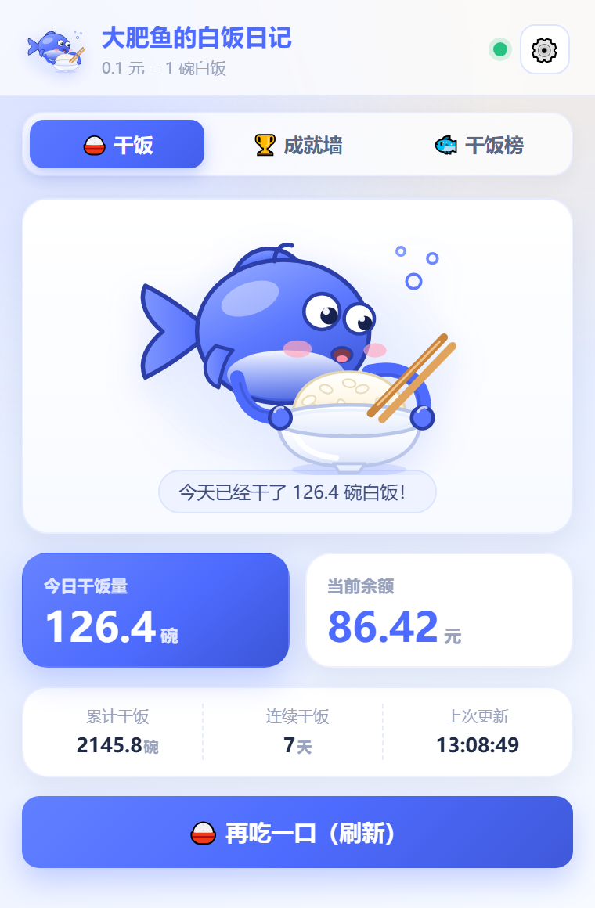
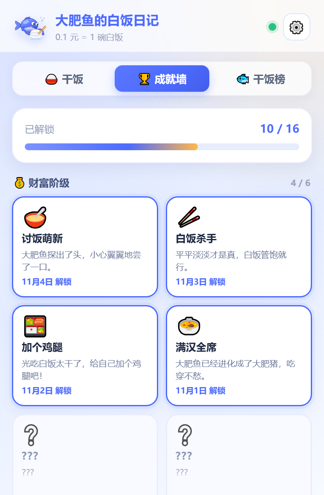
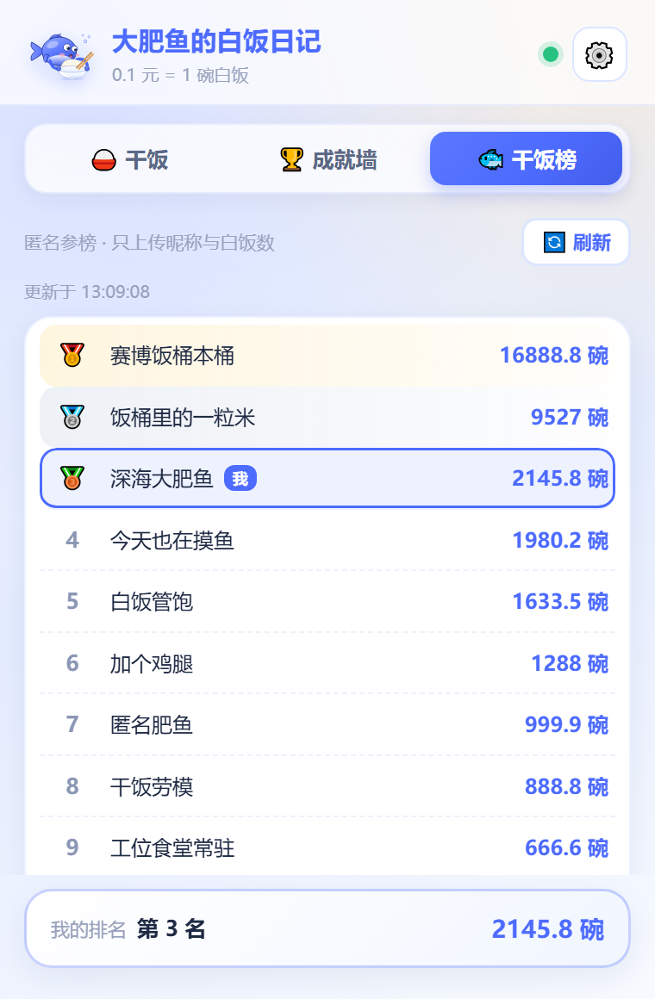

<p align="center">
  
</p>

<h1 align="center">🐟 大肥鱼的白饭日记</h1>

<p align="center">
  <strong>DeepSeek 每花掉 0.1 元，就有一条大肥鱼替你吃下一碗白饭。</strong><br>
  纯本地记账 · 16 个赛博干饭人成就 · 可选匿名排行榜
</p>

<p align="center">
  
  
  
  
</p>

> 这不是一个严肃的财务工具，这是一份赛博打工人给自己开的「干饭体检报告」。

## 📖 目录

- [这是什么](#-这是什么)
- [功能特性](#-功能特性)
- [截图](#-截图)
- [成就墙](#-成就墙)
- [快速开始](#-快速开始)
- [环境变量](#-环境变量)
- [API 文档](#-api-文档)
- [项目结构](#-项目结构)
- [防作弊设计](#-防作弊设计)
- [隐私说明](#-隐私说明)
- [形象素材](#-形象素材)
- [常见问题](#-常见问题)
- [免责声明](#-免责声明)
- [贡献指南](#-贡献指南)
- [发布到 GitHub](#-发布到-github)
- [License](#-license)

## 🍚 这是什么

事情的起因很简单：有人第一次看到 DeepSeek 的蓝色小鲸鱼 Logo，脱口而出「这不就是一条大肥鱼吗」；又有人发现，调用 API 烧 Token 的钱，花得跟食堂打饭一样悄无声息。于是两个梗合体了——

**读一次 DeepSeek API 余额，把花掉的钱换算成白饭，然后让一条大肥鱼替你记账。**

- 换算规则：**0.1 元 = 1 碗白饭**（1 元 = 10 碗）。这是纯玩梗，不是 DeepSeek 官方汇率，也不涉及任何真实交易。
- 记账方式：纯本地。API Key 只存在浏览器里，插件直接请求 `api.deepseek.com` 查余额，用前后两次余额的差值算「这一口吃了多少」。
- 排行榜：可选功能。想比一比谁是饭桶，就自己部署一个 Vercel 后端 + Supabase 数据库；不想参与，关掉开关即可，本地记账照常工作。
- 形态：Chrome Manifest V3 原生扩展，**没有构建步骤**，`chrome://extensions` 里「加载已解压的扩展程序」就能跑。

## ✨ 功能特性

- 🍚 **余额抓取**：调用 DeepSeek 官方余额接口，优先读 CNY；余额增加（充值 / 退款）只记退款事件，不算干饭。
- 🧮 **白饭换算**：金额保留 2 位小数，白饭保留 1 位小数，`0.1 元 = 1 碗`，换算逻辑写在 `extension/shared.js` 里，Popup 和后台共用一份。
- 📅 **今日 / 累计 / 连续**：今日干饭量、累计干饭量、连续干饭天数三条线一起记，跨天自动把「今日」清零，累计不动。
- 🏆 **16 个成就**：财富阶级 6 个、连吃天数 3 个、特殊事件 4 个、排行榜互动 3 个，解锁时弹赛博 Toast，成就墙里置灰显示 `???`。
- 🎉 **Toast 提醒**：成就解锁、错误提示、设置保存全部走 Toast；后台定时刷新攒下的成就，下次打开 Popup 也会补弹。
- ⏰ **定时刷新**：`chrome.alarms` 定时查余额，间隔可选 15 / 30 / 60 / 120 分钟，默认 30 分钟；图标角标显示今日白饭碗数，超过 99 显示 `99+`。
- 🐟 **匿名排行榜**：只上传「随机 UUID + 昵称 + 累计白饭碗数」，展示 Top N 和自己的名次，前三名金银铜配色。
- 🛡️ **防作弊**：5 分钟内白饭暴增超过 500 碗直接没收成绩，数据库侧原子判定，改前端代码没用。
- 🙈 **隐私优先**：没有埋点、没有统计、不上传 API Key，也不返回任何 `deviceId`。
- ⌨️ **无构建依赖**：扩展目录是纯静态文件，改完代码刷新扩展就生效；后端只有两个接口、几个小工具函数和一份 SQL。

## 📸 截图

### 主界面：今天也要好好干饭


> 今日 126.4 碗，余额 86.42 元，连续干饭 7 天。这位蓝发、鲸鱼尾巴的大肥鱼娘，像极了月底盯着工资条的你。

### 成就墙：已解锁的都得摆出来



> 已解锁 10 / 16，剩下六个还在 `???` 里装死。财富阶级 4 / 6，离「黑洞吞噬者」还差一次失控的 prompt。

### 干饭榜：比上不足，比下很有成就感



> 第 3 名，2145.8 碗。前面还有 9527 碗和 16888.8 碗——榜首那位不是在干饭，是在给机房供暖。

## 🏆 成就墙

共 16 个成就，`id`、emoji、名称、条件、文案与 `extension/shared.js` 中的 `ACHIEVEMENTS` 数组完全一致。成就是一次性解锁的，解锁时间存在 `chrome.storage.local`，不会重复弹。

| id | 分组 | Emoji | 名称 | 解锁条件 | 文案 |
| --- | --- | --- | --- | --- | --- |
| `wealth_rookie` | 财富 | 🥣 | 讨饭萌新 | 累计干饭 1 碗 | 大肥鱼探出了头，小心翼翼地尝了一口。 |
| `wealth_killer` | 财富 | 🥢 | 白饭杀手 | 累计干饭 50 碗 | 平平淡淡才是真，白饭管饱就行。 |
| `wealth_chicken` | 财富 | 🍱 | 加个鸡腿 | 累计干饭 200 碗 | 光吃白饭太干了，给自己加个鸡腿吧！ |
| `wealth_feast` | 财富 | 🍲 | 满汉全席 | 累计干饭 1000 碗 | 大肥鱼已经进化成了大肥猪，吃穿不愁。 |
| `wealth_bucket` | 财富 | 👑 | 赛博饭桶 | 累计干饭 5000 碗 | 老板，再来一桶！这鱼疯了！ |
| `wealth_blackhole` | 财富 | 🌌 | 黑洞吞噬者 | 累计干饭 10000 碗 | 连光都无法逃离大肥鱼的胃。 |
| `streak_three` | 连吃 | 🌱 | 一日三餐 | 连续干饭 3 天 | 大肥鱼学会了定点进食。 |
| `streak_seven` | 连吃 | 🔥 | 干饭劳模 | 连续干饭 7 天 | 风雨无阻，哪怕报错也要吃白饭。 |
| `streak_thirty` | 连吃 | ⏳ | 海枯石烂 | 连续干饭 30 天 | 这鱼是把工位搬到食堂了吗？ |
| `special_near_death` | 特殊 | 💸 | 濒死体验 | 余额低于 1 元 | 大肥鱼饿得翻白眼了，快充值！ |
| `special_hibernation` | 特殊 | 🛌 | 吃饱就睡 | 连续 3 天没吃上饭 | 大肥鱼进入了冬眠。 |
| `special_binge` | 特殊 | 🌪️ | 暴饮暴食 | 单次刷新消耗超过 10 元 | 一口气吃下 100 碗！你拿我当牛使呢？ |
| `special_diet` | 特殊 | 📉 | 赛博减肥 | 余额神秘增加（退款/退订） | 吃进去的白饭还能吐出来？医学奇迹！ |
| `rank_fry` | 排行榜 | 🐟 | 鱼苗 | 参与匿名排行榜 | 饭桶里的一粒米。 |
| `rank_whale` | 排行榜 | 🐳 | 深海巨物 | 冲进榜单前三 | 让一让，大肥鱼来清场了。 |
| `rank_king` | 排行榜 | 🏆 | 鱼王 | 登顶榜单第一 | 整个服务器的白饭，由我一人承包！ |

几个容易踩的判定细节：

- 「吃饱就睡」看的是最近一次有消耗的日期距今天数是否 ≥ 3 天，需要插件再刷新一次才会判定。
- 「鱼苗 / 深海巨物 / 鱼王」需要开启排行榜同步并成功上报；关掉同步就永远解锁不了。
- 「暴饮暴食」要求**单次**刷新消耗严格大于 10 元，攒很多次小额消耗不算。
- 「赛博减肥」只统计余额变多（退款 / 退订）的次数，白饭不会因此减少。

## 🚀 快速开始

### 0. 前置条件

- Chrome 102 及以上（扩展声明了 `minimum_chrome_version: "102"`）。
- 一个 DeepSeek API Key（在 DeepSeek 开放平台创建，形如 `sk-` 开头的字符串）。
- 可选：Supabase 账号 + Vercel 账号，只有你想玩匿名排行榜时才需要。
- 可选：Node.js 20 及以上，用于跑后端依赖和单元测试。

### 1. 建数据库（Supabase）

1. 登录 Supabase，新建一个项目，等它初始化完成。
2. 打开左侧 **SQL Editor**，把仓库里 `supabase/schema.sql` 的全部内容粘贴进去，点 **Run**。
3. 脚本会建 `public.rankings` 表、复合索引、防作弊函数 `report_rank`，并开启 RLS；脚本是幂等的，重复执行不会报错。
4. 到 **Project Settings → API** 里记下两个值：`Project URL`（形如 `https://xxxx.supabase.co`）和 `service_role` 密钥。

> ⚠️ `service_role` 密钥能绕过 RLS，**只能放在服务端**。别写进扩展，别提交到 Git，别发到群里。

### 2. 部署后端（Vercel）

1. 把本仓库推到自己的 GitHub，然后在 Vercel 里 **Add New → Project** 导入这个仓库。
2. **Root Directory 留空**（用仓库根目录），Framework Preset 选 **Other**，Build Command 和 Output Directory 都留空。
3. 在 **Environment Variables** 里加两条：`SUPABASE_URL` 填 Project URL，`SUPABASE_SERVICE_ROLE_KEY` 填 service_role 密钥，Production / Preview / Development 三个环境都勾上。
4. 点 Deploy。部署完成后记下分配到的域名，形如 `https://your-project.vercel.app`。
5. 验证一下：浏览器打开 `https://your-project.vercel.app/api/rank/top?limit=1`，能看到 `{"ok":true,"updatedAt":1762312345678,"ranks":[],"me":null}` 这样的 JSON 就说明后端和数据库通了。

### 3. 配置扩展的后端地址

扩展里的默认地址 `https://bigfatfish-riceeater.vercel.app` **只是示例占位**，作者不保证它在线可用。请改成你自己的域名，两种方式任选其一：

- 装好扩展后，点右上角齿轮 → 「后端 API 地址（高级）」填自己的 Vercel 域名 → 保存设置（保存时会自动去掉结尾的斜杠）。
- 或者直接改 `extension/shared.js` 里的 `DEFAULT_SETTINGS.apiBase` 字段，再重新加载扩展。

### 4. 加载扩展

Windows 和 macOS 操作一致：

1. 打开 `chrome://extensions`。
2. 右上角打开「开发者模式」。
3. 点「加载已解压的扩展程序」，选择仓库里的 **`extension`** 目录（不是仓库根目录）。
4. 扩展出现在列表里后，点工具栏的拼图图标，把「大肥鱼的白饭日记」固定出来。

### 5. 填 Key，开饭

1. 点扩展图标打开 Popup，点右上角齿轮进设置。
2. 填 DeepSeek API Key、排行榜昵称（默认「匿名肥鱼」），需要排行榜就保持「参与匿名排行榜」开启。
3. 点「保存设置」，再点「测试连接」，看到「✅ 连接成功，余额 X 元」就通了。
4. 回到「🍚 干饭」页，点「再吃一口（刷新）」。

**第一次刷新只记录基准余额，不会产生白饭**，这是为了防止一装插件就白嫖一堆成就。之后余额因 API 消耗而下降，才会换算成白饭。

### 6. 本地跑测试（可选）

```bash
npm install
npm test
```

`npm test` 执行的是 `node tests/logic.test.js`，覆盖换算、跨天、连吃天数、成就判定、防作弊响应解析等纯逻辑。扩展本身不需要构建，改完 `extension/` 里的文件，在 `chrome://extensions` 点一下刷新按钮即可。

## 🔐 环境变量

后端只需要两个环境变量，示例见 `.env.example`：

| 变量名 | 必填 | 说明 |
| --- | --- | --- |
| `SUPABASE_URL` | 是 | Supabase 项目地址（Project URL），形如 `https://xxxx.supabase.co` |
| `SUPABASE_SERVICE_ROLE_KEY` | 是 | Supabase 服务端密钥（service_role secret），拥有绕过 RLS 的权限 |

安全警告，请务必读完：

- 两个变量只允许存在于 Vercel 环境变量或本地 `.env`，`.env` 已被 `.gitignore` 忽略。
- **绝对不要**把 `SUPABASE_SERVICE_ROLE_KEY` 写进 Chrome 扩展。扩展端只需要一个后端 API 地址，永远不需要任何 Supabase 密钥。
- 如果怀疑密钥泄露，立刻去 Supabase 控制台轮换 service_role key，并同步更新 Vercel 环境变量。
- 数据库已开启 RLS 且不提供任何策略，anon / authenticated 角色读不到排行榜；只有服务端能访问。

## 🧩 API 文档

Base URL 就是你的 Vercel 域名。所有响应都是 JSON；CORS 允许任意来源，`Access-Control-Allow-Origin: *`，允许方法 `GET, POST, OPTIONS`，允许请求头 `Content-Type`，`OPTIONS` 预检返回 `204`。

### POST /api/rank/update

匿名上报累计白饭碗数，服务端会校验并做防作弊判定。

请求头：`Content-Type: application/json`，请求体上限 4KB。

```json
{
  "deviceId": "3f2504e0-4f89-41d3-9a0c-0305e82c3301",
  "nickname": "匿名肥鱼",
  "totalRice": 123.4
}
```

字段约束：

- `deviceId`：小写或大写 UUID 均可，服务端统一转小写；必须匹配 `^[0-9a-f]{8}-[0-9a-f]{4}-[1-5][0-9a-f]{3}-[89ab][0-9a-f]{3}-[0-9a-f]{12}$`。
- `nickname`：去掉控制字符后 1–20 个 Unicode 字符，超长截断，空值回落为「匿名肥鱼」。
- `totalRice`：纯数字（JSON number），范围 0 到 10000000，服务端四舍五入到 1 位小数。

成功（HTTP 200）：

```json
{
  "ok": true,
  "rejected": false,
  "rank": 12,
  "totalRice": 123.4,
  "nickname": "匿名肥鱼"
}
```

被防作弊拦截（HTTP 200，方便客户端直接展示原因，不写入新值）：

```json
{
  "ok": false,
  "rejected": true,
  "reason": "RATE_LIMIT",
  "message": "5 分钟内白饭暴增超过 500 碗，本次成绩已被没收。",
  "retryAfterSeconds": 237
}
```

错误码：

| 状态码 | code | 含义 |
| --- | --- | --- |
| 400 | `INVALID_DEVICE_ID` | deviceId 不是合法 UUID |
| 400 | `INVALID_TOTAL_RICE` | totalRice 不是数字或超出范围 |
| 400 | `INVALID_JSON` | 请求体不是合法 JSON 对象 |
| 400 | `PAYLOAD_TOO_LARGE` | 请求体超过 4KB |
| 405 | `METHOD_NOT_ALLOWED` | 用了 POST / OPTIONS 以外的方法 |
| 500 | `CONFIG_MISSING` | 服务端缺少 `SUPABASE_URL` 或 `SUPABASE_SERVICE_ROLE_KEY` |
| 500 | `DB_ERROR` | 数据库操作失败 |
| 504 | `SUPABASE_TIMEOUT` | Supabase 调用超过 8 秒 |

### GET /api/rank/top

公开干饭榜。参数：

| 参数 | 必填 | 说明 |
| --- | --- | --- |
| `limit` | 否 | 返回条数，1–100 的整数，默认 50 |
| `deviceId` | 否 | 合法 UUID，用于返回「我的排名」；不传则 `me` 为 `null` |

成功（HTTP 200）：

```json
{
  "ok": true,
  "updatedAt": 1762312345678,
  "ranks": [
    {
      "rank": 1,
      "nickname": "深海大肥鱼",
      "totalRice": 8888.8,
      "updatedAt": 1762312345678
    }
  ],
  "me": {
    "rank": 42,
    "nickname": "匿名肥鱼",
    "totalRice": 66.6
  }
}
```

说明：

- `me.rank` 按「严格比你白饭多的人数 + 1」计算，同分并列；`ranks` 列表里的 `rank` 是展示顺序。`me` 未上榜或未传 `deviceId` 时为 `null`。
- 响应里**永远不会**出现 `deviceId`，隐私字段只留在数据库。
- 错误：`400 INVALID_LIMIT`、`400 INVALID_DEVICE_ID`、`405 METHOD_NOT_ALLOWED`、`500 CONFIG_MISSING`、`500 DB_ERROR`、`504 SUPABASE_TIMEOUT`。

## 📁 项目结构

```text
bigfatfish-riceeater/
├── .github/
│   ├── workflows/ci.yml           # Actions：语法检查 + 27 项逻辑测试
│   ├── ISSUE_TEMPLATE/            # Bug / 功能建议模板
│   ├── pull_request_template.md
│   └── dependabot.yml
├── extension/                     # Chrome MV3 扩展，直接加载这个目录
│   ├── manifest.json              # MV3 清单：storage / alarms 权限与 host_permissions 白名单
│   ├── popup.html                 # 主界面 + 成就墙 + 干饭榜 + 设置（内联 CSS）
│   ├── popup.js                   # UI 渲染、交互、Toast
│   ├── shared.js                  # 共享核心逻辑：换算、成就、存储、网络、刷新编排
│   ├── background.js              # Service Worker：chrome.alarms、角标、消息处理
│   ├── assets/
│   │   ├── deepseek-chibi.webp       # 完整立绘：Popup 主界面形象
│   │   ├── deepseek-chibi-avatar.webp# Header 圆形头像（立绘裁切）
│   │   └── ATTRIBUTION.md            # 形象素材来源与授权说明
│   └── icons/
│       ├── icon16.png
│       ├── icon32.png
│       ├── icon48.png
│       └── icon128.png
├── api/
│   ├── rank/
│   │   ├── update.js              # POST /api/rank/update
│   │   └── top.js                 # GET  /api/rank/top
│   └── _lib/
│       ├── supabase.js            # Supabase 客户端懒加载单例
│       ├── http.js                # CORS、JSON 响应、4KB 读体、8 秒超时
│       └── validate.js            # UUID / 昵称 / 白饭数 / limit 校验
├── supabase/
│   └── schema.sql                 # 建表 + 索引 + RLS + 防作弊 RPC
├── tests/
│   └── logic.test.js              # 纯逻辑单元测试，node tests/logic.test.js
├── scripts/
│   ├── make_icons.py              # 生成扩展图标
│   └── make_social_preview.py     # 生成 GitHub 社交预览图
├── docs/
│   ├── SPEC.md                    # 开发契约，接口与行为的唯一事实来源
│   ├── PUBLISH_TO_GITHUB.md       # 发布到 GitHub 的完整操作手册
│   ├── RELEASE_NOTES_v1.1.0.md    # Release 文案模板
│   ├── social-preview.png         # 1280×640 社交预览图
│   ├── screenshot-main.png
│   ├── screenshot-achievements.png
│   └── screenshot-rank.png
├── .env.example                   # 服务端环境变量示例
├── .gitattributes                 # 统一 LF 换行、标记二进制资源
├── .gitignore
├── CONTRIBUTING.md                # 贡献指南
├── CODE_OF_CONDUCT.md             # 行为准则
├── SECURITY.md                    # 漏洞报告流程
├── CHANGELOG.md                   # 版本变更记录
├── package.json                   # 后端依赖与 test 脚本
├── vercel.json                    # Serverless 函数超时配置
├── README.md
└── LICENSE
```

## 🔒 防作弊设计

排行榜是公开的，所以得防一手「打开 DevTools 改个数」的冲动。设备用随机 UUID 标识（数据库主键 `device_id`），规则分三层：

1. **增长速率限制**：同一个 `device_id` 上次被接受的上报如果在 **5 分钟内**，本次 `totalRice` 比上次上报值增长 **超过 500 碗**，直接拒绝，不写入，保留旧值，并返回 `retryAfterSeconds`。
2. **数据库原子执行**：防作弊逻辑写在 Supabase 的 `report_rank` RPC 里，用 `pg_advisory_xact_lock` 把同一设备的请求串行化，前端改代码、并发刷接口都绕不过去。首次上报没有增长限制；允许白饭数下降（用户清空重置），但不允许为负。
3. **权限收紧**：`rankings` 表开启 RLS 且不给 anon / authenticated 任何策略，表权限和函数执行权限都 `revoke` 掉，只 `grant` 给 `service_role`；`service_role` 只存在于 Vercel 环境变量，不下发给扩展，也不进 Git。

另外，昵称会去掉控制字符和零宽字符、按 Unicode 字符截断到 20 个，白饭数上限 10000000 碗；接口只返回展示字段，不返回 UUID。

## 🙈 隐私说明

- **API Key 只存在本地**：`chrome.storage.local`，不经过任何中间服务器；查余额时由扩展直接请求 `https://api.deepseek.com/user/balance`。
- **排行榜最小化上传**：只上传随机生成的 UUID、昵称、累计白饭碗数。UUID 用来认设备，不含账号、邮箱、手机号。
- **不采集 IP**：代码里没有 IP 记录、没有访问日志、没有统计脚本。Vercel 和 Supabase 平台自身的基础设施日志由其平台策略决定，本项目不读取也不使用。
- **不返回设备标识**：`/api/rank/top` 的响应里没有 `deviceId`，别人无法反查你的设备。
- **可随时清空**：设置页有「清空本地数据（危险）」，会移除设置、状态、成就、榜单缓存；卸载扩展时 Chrome 也会清掉本地存储，下次安装会生成新的 UUID。
- **昵称请勿用真名**：排行榜是公开的，默认值「匿名肥鱼」就挺好。

## 🎨 形象素材

当前 Popup 里的「大肥鱼娘」是使用者指定替换的社区二创形象（蓝发、鲸鱼尾巴、女仆装），不是手绘 SVG，也不属于 DeepSeek 官方素材。

<p align="center">
  
</p>

| 文件 | 用途 | 说明 |
| --- | --- | --- |
| `extension/assets/deepseek-chibi.webp` | Popup 主界面立绘 | 941 × 1672 WebP，原始素材 |
| `extension/assets/deepseek-chibi-avatar.webp` | Header 圆形头像、图标输入 | 640 × 640 WebP，由立绘裁切 |
| `extension/assets/ATTRIBUTION.md` | 来源与授权说明 | 详见该文件 |

- 原始来源：<https://fisharchive.cc/character-art/v1/download/deepseek-chibi.webp>，获取于 2026-11-05。
- **授权提示**：仓库没有从来源页确认到明确的再分发许可，因此这张图**不适用**根目录的 MIT 代码许可，版权归原作者 / 来源平台所有；商用、二次分发或衍生作品前请自行取得授权。
- 如果你是该素材的权利人并希望本项目替换或下架，请直接开 Issue，我们会尽快处理。

## ❓ 常见问题

### 刷新了，余额和今日白饭为什么没变？

三种常见情况：

1. **第一次刷新只记基准**。没有上一次余额就没有差值，所以第一次永远是 0 碗，第二次开始才结算。
2. **确实还没花钱**。只有余额下降才算干饭；充值让余额变多不会增加白饭，只会让「赛博减肥」计数加一。
3. **刷新不够勤**。默认 30 分钟自动查一次，余额接口本身也不是实时推送的计费流水，短时间内看不到变化很正常。想立刻看结果就点「再吃一口」，或把自动刷新调到 15 分钟。

### 设置里测试连接报 401 / 403？

API Key 无效、过期或没有余额查询权限。去 DeepSeek 开放平台重新创建 Key，复制时注意不要带多余空格或换行；插件内部已经自动加 `Bearer` 前缀，不需要自己写。

### 干饭榜一直是空的，或者我的名次不动？

按顺序排查：

1. 后端没部署：用浏览器访问 `https://你的域名/api/rank/top?limit=1`，不是 JSON 就说明部署或环境变量有问题。
2. 后端地址没改：默认的 `https://bigfatfish-riceeater.vercel.app` 只是示例，必须换成你自己的域名。
3. 没开同步：设置里「参与匿名排行榜」要打开，且累计白饭要大于 0。
4. 被 5 分钟 / 500 碗规则拦了：等 `retryAfterSeconds` 秒后再试，插件也会进入冷却。
5. 刚同步过：两次同步之间有 15 秒节流，属于正常现象。

### 想用自己的域名（不是 vercel.app）怎么办？

扩展的 `host_permissions` 只白名单了 `https://api.deepseek.com/*`、`https://*.vercel.app/*` 和 `http://localhost:3000/*`。如果你的后端挂在自定义域名上，需要在 `extension/manifest.json` 的 `host_permissions` 里加一条，例如 `https://rank.example.com/*`，然后在设置页填同样的地址，重新加载扩展。本地调试用 `http://localhost:3000` 也可以。

### 成就为什么一直不解锁？

先看条件：财富类需要累计碗数达标，连吃类需要连续天数，特殊事件需要触发对应场景，排行榜三个成就必须成功上报过榜单。成就墙里未解锁的卡片会显示条件提示；「吃饱就睡」要等最近一次干饭过去 3 天后再刷新一次才会判定。

### 怎么清空数据、换一台设备？

设置页点「清空本地数据（危险）」，确认后会移除本地设置、状态、成就和榜单缓存，相当于重新投胎，下次会自动生成新 UUID。注意：这不会删除你之前上报到别人后端的排行榜记录；如果那是你自己的 Supabase，去表里删对应行即可。卸载扩展也会清空本地数据。

### 0.1 元 = 1 碗是官方汇率吗？

不是。这是本项目自造的玩梗汇率，只用于把 API 消耗翻译成好玩的数字，不构成任何价格、结算或交易依据。真实的计费以 DeepSeek 官方账单为准，本项目不涉及任何真实交易。

### 能在手机上用吗？

不能。Chrome 移动端不支持桌面扩展；本项目只面向桌面版 Chrome（以及内核兼容的 Chromium 浏览器）。

## 📜 免责声明

- 本项目**不是 DeepSeek 官方项目**，与 DeepSeek 官方没有任何隶属或合作关系；「DeepSeek Logo 像大肥鱼」只是社区玩梗。
- 形象素材来自 [fisharchive.cc](https://fisharchive.cc/character-art/v1/download/deepseek-chibi.webp)（由使用者指定替换），**不是 DeepSeek 官方素材**；代码采用 MIT，但图片素材不包含在 MIT 授权范围内，商用/再分发前请自行确认授权。DeepSeek 名称及相关商标归其权利人所有。
- 「0.1 元 = 1 碗白饭」是虚构的趣味换算，不代表真实价格，也不涉及任何真实交易。
- 排行榜昵称是公开可见的，**请勿使用真实姓名、手机号、邮箱或其他个人信息**；因昵称泄露造成的后果由使用者自行承担。
- API 调用产生的费用由使用者自行承担；本项目不代管、不代付、不报销。
- 如果你把后端部署在公网，你就是那个后端的运营者，请自行负责数据与合规。
- 软件按 MIT 协议「按原样」提供，不附带任何明示或暗示的担保。

## 🤝 贡献指南

完整流程见 [CONTRIBUTING.md](CONTRIBUTING.md)；安全问题请按 [SECURITY.md](SECURITY.md) 私下报告；参与本项目即表示同意 [CODE_OF_CONDUCT.md](CODE_OF_CONDUCT.md)。第一次发布到 GitHub 可以照着 [docs/PUBLISH_TO_GITHUB.md](docs/PUBLISH_TO_GITHUB.md) 做。

- 先读 `docs/SPEC.md`，接口、存储结构、成就判定都以它为准；改动行为时请同步更新 SPEC 和 README。
- Bug 和小改动直接提 PR；大改动先开 Issue 聊聊，避免白干。
- 跑一遍 `npm test`，扩展相关的改动至少手动在 `chrome://extensions` 里加载验证一次。
- 代码风格：UTF-8、LF、中文注释；扩展不使用远程代码、不使用 `eval`、不引外部字体和框架。
- 新增成就请改 `extension/shared.js` 的 `ACHIEVEMENTS`，并同步 README 成就表；成就 ID 一旦发布不要改。
- 不要提交任何密钥、`.env`、`node_modules`、`.vercel` 目录。
- 提交信息写清楚「改了什么、为什么改」，中英文都行。

## 🚀 发布到 GitHub

仓库已经包含 CI、Issue / PR 模板、贡献指南、安全策略、变更记录和 1280×640 社交预览图。第一次发布可以照着 [docs/PUBLISH_TO_GITHUB.md](docs/PUBLISH_TO_GITHUB.md) 操作，里面有：

- 推送到 GitHub 的完整命令
- 仓库 About 的中英文描述与 Topics 列表
- v1.1.0 Release 文案（[docs/RELEASE_NOTES_v1.1.0.md](docs/RELEASE_NOTES_v1.1.0.md)）
- GitHub Actions / 安全设置 / 素材授权注意事项

发布前最重要的一句：**当前形象是社区二创素材，公开仓库前请先确认授权，否则建议先保持 Private 或替换素材。**

## 📄 License

本项目采用 [MIT License](LICENSE)，Copyright (c) 2026 BigFatFish RiceEater Contributors。

---

**白饭吃多了会胖，Token 烧多了会穷。愿你余额常青，成就全亮。**

—— 大肥鱼，于某个月底的深夜
